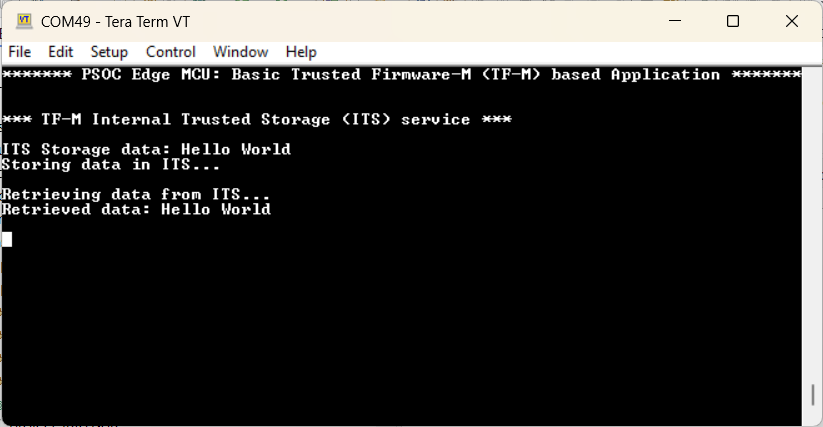

# PSOC&trade; Edge MCU: Basic Trusted Firmware-M (TF-M) application

This is a basic code example for getting started with Trusted Firmware-M (TF-M) on Infineon's PSOC&trade; Edge MCU. The example demonstrates how to initialize the TF-M NS interface in CM33 NS project and use the services offered by TF-M with PSA APIs. The code example is designed to work on PSOC&trade; Edge MCUs. For more information on Edge Protect categories, see [Infineon Edge Protect](https://www.infineon.com/promo/edge-protect).

This code example has a three project structure - CM33 secure, CM33 non-secure, and CM55 project.

- **proj_cm33_s:** TF-M is available as source code in the *mtb_shared* directory. proj_cm33_s is completely built out of this TF-M library. Only *Makefile* and dependencies are present in this project directory that makes use of TF-M library. On EPC2 targets, the TF-M application is executed from the external flash; on EPC4 targets, the TF-M application is loaded from the external flash to the SRAM for execution

- **proj_cm33_ns:** The NSPE project that contains the TF-M interface and calls the PSA APIs to use TF-M services. The CM33 NS application is executed from the external flash and does not use RTOS

- **proj_cm55:** The M55 NSPE project; while it also has the TF-M interface, it does not call the PSA APIs. Include the required PSA interface header files and the project is ready to use PSA APIs. The CM55 project is executed from the external flash and does not use RTOS

[View this README on GitHub.](https://github.com/Infineon/mtb-example-psoc-edge-tfm-basic)

[Provide feedback on this code example.](https://yourvoice.infineon.com/jfe/form/SV_1NTns53sK2yiljn?Q_EED=eyJVbmlxdWUgRG9jIElkIjoiQ0UyNDM2MzMiLCJTcGVjIE51bWJlciI6IjAwMi00MzYzMyIsIkRvYyBUaXRsZSI6IlBTT0MmdHJhZGU7IEVkZ2UgTUNVOiBCYXNpYyBUcnVzdGVkIEZpcm13YXJlLU0gKFRGLU0pIGFwcGxpY2F0aW9uIiwicmlkIjoiamFsZGVlcG1hbnN1a2hiaGFpLnJhbWFuaUBpbmZpbmVvbi5jb20iLCJEb2MgdmVyc2lvbiI6IjEuMC4wIiwiRG9jIExhbmd1YWdlIjoiRW5nbGlzaCIsIkRvYyBEaXZpc2lvbiI6Ik1DRCIsIkRvYyBCVSI6IklDVyIsIkRvYyBGYW1pbHkiOiJQU09DIn0=)

See the [Design and implementation](docs/design_and_implementation.md) for the functional description of this code example.

## Requirements

- [ModusToolbox&trade;](https://www.infineon.com/modustoolbox) v3.9 or later (tested with v3.9)
- Board support package (BSP) minimum required version for:
   - KIT_PSE84_EVAL_EPC2: v1.5.0 or later
   - KIT_PSE84_EVAL_EPC4: v1.5.0 or later
- Programming language: C
- Other tools: Python v3.10 or later
- Associated parts: All [PSOC&trade; Edge E84 MCU](https://www.infineon.com/products/microcontroller/32-bit-psoc-arm-cortex/32-bit-psoc-edge-arm/psoc-edge-e84) parts

## Supported toolchains (make variable 'TOOLCHAIN')

- GNU Arm&reg; Embedded Compiler v14.2.1 (`GCC_ARM`) – Default value of `TOOLCHAIN`
- Arm&reg; Compiler v6.22 (`ARM`)
- IAR C/C++ Compiler v9.70.4 (`IAR`)

## Supported kits (make variable 'TARGET')

- [PSOC&trade; Edge E84 Evaluation Kit](https://www.infineon.com/KIT_PSE84_EVAL) (`KIT_PSE84_EVAL_EPC2`) – Default value of `TARGET`
- [PSOC&trade; Edge E84 Evaluation Kit](https://www.infineon.com/KIT_PSE84_EVAL) (`KIT_PSE84_EVAL_EPC4`)

## Hardware setup

This example does not use the board's default configuration.

Ensure the following jumper and pin configuration on board:
- BOOT SW must be in the LOW/OFF position
- J20 and J21 must be in the tristate/not connected (NC) position

## Software setup

See the [ModusToolbox&trade; tools package installation guide](https://www.infineon.com/ModusToolboxInstallguide) for information about installing and configuring the tools package.

Install a terminal emulator if you do not have one. Instructions in this document use [Tera Term](https://teratermproject.github.io/index-en.html).

This example requires no additional software or tools.

## Operation

### Add the Edge Protect Bootloader

1. Add **proj_bootloader** to this code example. Follow steps 2 to 9 in the **Operation** section of the [Edge Protect Bootloader](https://github.com/Infineon/mtb-example-edge-protect-bootloader) code example's *README.md* file

   > **Note:** [Edge Protect Bootloader](https://github.com/Infineon/mtb-example-edge-protect-bootloader) *README.md* describes how to add the bootloader to **Basic Secure App**. Add it to **this** code example instead

### Program the application

See [Using the code example](docs/using_the_code_example.md) for instructions on creating a project, opening it in various supported IDEs, and performing tasks such as building, programming, and debugging the application within the respective IDEs.

> **Note:** Windows has a 260 character path length limit, so for the TF-M application to build successfully, ensure that <WorkspacePath>\<Application Name> path (including back slash) is less than or equal to 32 characters.

2. Connect the board to your PC using the provided USB cable through the KitProg3 USB connector

3. Open a terminal program and select the KitProg3 COM port. Set the serial port parameters to 8N1 and 115200 baud

4. Program the board with the TF-M application. After programming, the application starts automatically. Confirm that "PSOC Edge MCU: Basic Trusted Firmware-M (TF-M) based Application" is displayed on the UART terminal

   **Figure 1. Terminal output on program startup**

   

## Related resources

Resources  | Links
-----------|----------------------------------
Application notes  | [AN235935](https://www.infineon.com/AN235935) – Getting started with PSOC&trade; Edge E84 MCU on ModusToolbox&trade; software   AN240096 – Getting started with Trusted Firmware-M (TF-M) on PSOC&trade; Edge
Code examples  | [Using ModusToolbox&trade;](https://github.com/Infineon/Code-Examples-for-ModusToolbox-Software) on GitHub
Device documentation | [PSOC&trade; Edge MCU datasheet](https://www.infineon.com/products/microcontroller/32-bit-psoc-arm-cortex/32-bit-psoc-edge-arm#documents)   [PSOC&trade; Edge MCU reference manuals](https://www.infineon.com/products/microcontroller/32-bit-psoc-arm-cortex/32-bit-psoc-edge-arm#documents)
Development kits | Select your kits from the [Evaluation board finder](https://www.infineon.com/cms/en/design-support/finder-selection-tools/product-finder/evaluation-board)
Libraries  | [mtb-dsl-pse8xxgp](https://github.com/Infineon/mtb-dsl-pse8xxgp) – Device support library for PSE8XXGP   [retarget-io](https://github.com/Infineon/retarget-io) – Utility library to retarget STDIO messages to a UART port
Tools  | [ModusToolbox&trade;](https://www.infineon.com/modustoolbox) – ModusToolbox&trade; software is a collection of easy-to-use libraries and tools enabling rapid development with Infineon MCUs for applications ranging from wireless and cloud-connected systems, edge AI/ML, embedded sense and control, to wired USB connectivity using PSOC&trade; Industrial/IoT MCUs, AIROC&trade; Wi-Fi and Bluetooth&reg; connectivity devices, XMC&trade; Industrial MCUs, and EZ-USB&trade;/EZ-PD&trade; wired connectivity controllers. ModusToolbox&trade; incorporates a comprehensive set of BSPs, HAL, libraries, configuration tools, and provides support for industry-standard IDEs to fast-track your embedded application development

 

## Other resources

Infineon provides a wealth of data at [www.infineon.com](https://www.infineon.com) to help you select the right device, and quickly and effectively integrate it into your design.

## Document history

Document title: *CE243633* – *PSOC&trade; Edge MCU: Basic Trusted Firmware-M (TF-M) application*

 Version | Description of change
 ------- | ---------------------
 1.0.0   | New code example based on TF-M 2.3.X
 

All referenced product or service names and trademarks are the property of their respective owners.

The Bluetooth&reg; word mark and logos are registered trademarks owned by Bluetooth SIG, Inc., and any use of such marks by Infineon is under license.

PSOC&trade;, formerly known as PSoC&trade;, is a trademark of Infineon Technologies. Any references to PSoC&trade; in this document or others shall be deemed to refer to PSOC&trade;.

---------------------------------------------------------

(c) 2026, Infineon Technologies AG, or an affiliate of Infineon Technologies AG. All rights reserved.
This software, associated documentation and materials ("Software") is owned by Infineon Technologies AG or one of its affiliates ("Infineon") and is protected by and subject to worldwide patent protection, worldwide copyright laws, and international treaty provisions. Therefore, you may use this Software only as provided in the license agreement accompanying the software package from which you obtained this Software. If no license agreement applies, then any use, reproduction, modification, translation, or compilation of this Software is prohibited without the express written permission of Infineon.
 
Disclaimer: UNLESS OTHERWISE EXPRESSLY AGREED WITH INFINEON, THIS SOFTWARE IS PROVIDED AS-IS, WITH NO WARRANTY OF ANY KIND, EXPRESS OR IMPLIED, INCLUDING, BUT NOT LIMITED TO, ALL WARRANTIES OF NON-INFRINGEMENT OF THIRD-PARTY RIGHTS AND IMPLIED WARRANTIES SUCH AS WARRANTIES OF FITNESS FOR A SPECIFIC USE/PURPOSE OR MERCHANTABILITY. Infineon reserves the right to make changes to the Software without notice. You are responsible for properly designing, programming, and testing the functionality and safety of your intended application of the Software, as well as complying with any legal requirements related to its use. Infineon does not guarantee that the Software will be free from intrusion, data theft or loss, or other breaches (“Security Breaches”), and Infineon shall have no liability arising out of any Security Breaches. Unless otherwise explicitly approved by Infineon, the Software may not be used in any application where a failure of the Product or any consequences of the use thereof can reasonably be expected to result in personal injury.
